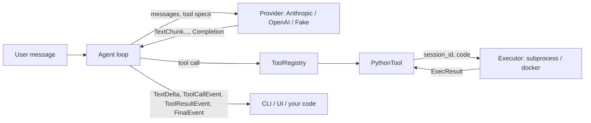

# code-interpreter-agent

A small agent that writes Python, runs it in an isolated worker process, reads the result, and
repeats until it can answer. About 1,950 lines of library code including the CLI and UI, no
agent framework, Python 3.11+.

The loop, the model providers, the executors and the tools are separate modules behind small
interfaces, so each can be replaced or reused alone.

## Quick start

    uv sync --extra anthropic
    export ANTHROPIC_API_KEY=...
    uv run cia                              # interactive REPL
    uv run cia -p "Plot y = x**2 for x in 0..10 and save it as parabola.png"

With OpenAI:

    uv sync --extra openai
    export OPENAI_API_KEY=...
    uv run cia --provider openai --model gpt-5

The CLI keeps each session's files in `./.cia-workspaces/<session id>/` and prints that path on
exit when the session wrote files. `--workspace-root` changes the location.

No key is needed for the examples, the tests, or the scripted demos:

    uv run python -m examples.run --list
    uv run python -m examples.run self_correct
    uv run pytest

Optional extras: `anthropic` and `openai` (provider SDKs), `ui` (Streamlit), `examples`
(matplotlib). The provider SDKs are not installed by default. `uv sync` also installs the dev
group, which includes matplotlib and numpy.

Demo UI: `uv sync --extra ui --extra anthropic` then
`uv run streamlit run src/code_interpreter_agent/ui/app.py`.

## Architecture



Source layout (`src/code_interpreter_agent/`):

| Path | Contents |
|---|---|
| `agent/` | `Agent` loop, event types, default system prompt |
| `providers/` | `Provider` protocol, Anthropic, OpenAI, scripted `FakeProvider` |
| `executors/` | `Executor` protocol, `worker.py`, `SubprocessExecutor`, `DockerExecutor` |
| `tools/` | `Tool` protocol, `ToolRegistry`, `PythonTool` |
| `cli/`, `ui/` | REPL and Streamlit demo |
| `factory.py` | `build_agent(...)` used by both interfaces |

## Public API

Everything below is importable from `code_interpreter_agent` and is the surface other projects
should depend on.

```python
from code_interpreter_agent import (
    Agent,
    build_agent,
    TextDelta,
    ToolCallEvent,
    ToolResultEvent,
    FinalEvent,
    SubprocessExecutor,
    DockerExecutor,
    get_executor,
    ExecResult,
    get_provider,
    AnthropicProvider,
    OpenAIProvider,
    FakeProvider,
    Tool,
    ToolResult,
    ToolRegistry,
    PythonTool,
    ToolCall,
)

executor = SubprocessExecutor(timeout_s=30, memory_mb=2048)
agent = Agent(get_provider("anthropic"), executor, system_prompt="You analyze data.")
for event in agent.run("session-1", "What is the sum of the first 100 primes?"):
    if isinstance(event, TextDelta):
        print(event.text, end="")
    elif isinstance(event, FinalEvent):
        print(f"\n[{event.stop_reason}, {event.usage.total} tokens]")
executor.close()
```

`Agent(provider, executor=None, tools=None, system_prompt=DEFAULT_SYSTEM_PROMPT, *,
max_iterations=10, max_total_tokens=None)`

* `run(session_id, message) -> Iterator[Event]`. Events: `TextDelta(text)`,
  `ToolCallEvent(call)`, `ToolResultEvent(call, result)`, and a last `FinalEvent(text,
  stop_reason, iterations, usage)`. `stop_reason` is `end_turn`, `max_iterations`,
  `token_budget` or `max_tokens`.
* `history(session_id)`, `reset(session_id)`. Conversation state and interpreter state are both
  per session. Run one message at a time per session; separate sessions may run in parallel threads.
* If `tools` is omitted and an executor is given, the tool list is `[PythonTool(executor)]`.
* `max_total_tokens` is checked before each model call against input plus output tokens used so
  far in the current message, so a run can exceed it by at most one model call.
* Provider exceptions (network, authentication, rate limits) propagate out of `run`.

`build_agent(provider="anthropic", *, model=None, executor="subprocess", executor_options=None,
extra_tools=(), system_prompt=..., max_iterations=10, max_total_tokens=None)` accepts names or
ready objects for `provider` and `executor`.

Protocols:

```python
class Provider(Protocol):
    name: str
    model: str

    def stream(
        self, *, system: str, messages: list[Message], tools: list[ToolSpec]
    ) -> Iterator[TextChunk | Completion]: ...


class Executor(Protocol):
    def run(
        self, session_id: str, code: str
    ) -> ExecResult: ...  # ExecResult(stdout, stderr, ok, files, duration_s)
    def reset(self, session_id: str) -> None: ...
    def close(self) -> None: ...
    def workspace_path(self, session_id: str) -> Path: ...


class Tool(Protocol):
    name: str
    description: str
    input_schema: dict

    def run(
        self, session_id: str, arguments: dict
    ) -> ToolResult: ...  # ToolResult(content, is_error, files)
```

Messages use Anthropic content blocks (`text`, `tool_use`, `tool_result`); the OpenAI provider
converts them. Session ids match `[A-Za-z0-9][A-Za-z0-9_.-]{0,63}`.

### Models and credentials

| Provider | Key variable | Model variable | Default model |
|---|---|---|---|
| anthropic | `ANTHROPIC_API_KEY` | `ANTHROPIC_MODEL` | `claude-sonnet-5-5` (also `claude-opus-5-5`, `claude-haiku-5-5`) |
| openai | `OPENAI_API_KEY` | `OPENAI_MODEL` | `gpt-5` |

Keys are read from the environment only. A missing key raises `MissingCredentialsError` naming the
variable. `OPENAI_BASE_URL` (read by the OpenAI SDK) points the OpenAI provider at a compatible server.
The default OpenAI model is a configurable default that has not been checked against the live API in
this repository; set `OPENAI_MODEL` to a model your account can use.

## Executors

| | `subprocess` (default) | `docker` |
|---|---|---|
| Isolation | Separate process, rlimits, audit hook | Container |
| Network | Host network: Internet, LAN, services on the host's localhost, Unix sockets the user can open | Loopback only (`--network none`); the `network` argument overrides it |
| Filesystem | Reads and writes confined to the workspace by an audit hook; read access to the Python installation | Read-only root, writable workspace mount and 128 MB `/tmp` tmpfs. No audit hook: subprocesses and reads anywhere in the container are allowed |
| Memory | `RLIMIT_AS`, default 2048 MB | cgroup `--memory`, same value, no swap |
| CPU | `RLIMIT_CPU` soft limit per call (default 30 s) | same, plus `--cpus 1` |
| Other | wall clock timeout (30 s), file size cap 256 MB | `--pids-limit 128`, `--cap-drop ALL`, `no-new-privileges`, host uid |
| Environment | 8 fixed variables, nothing inherited | Variables defined in the image, plus `HOME`, `TMPDIR`, `MPLCONFIGDIR` and `MPLBACKEND` set by the executor |

The wall clock timeout is enforced by the parent process and is the limit to rely on. The CPU
soft limit is set inside the worker; code that ignores `SIGXCPU` runs on until the wall clock
timeout.

Both keep one long-lived worker per session, so variables persist across calls. A timeout, CPU
limit or crash discards that session's interpreter state; the next call starts a fresh worker and
the error text says so. `reset(session_id)` also deletes the session's files.

Docker needs an image with Python 3.11+. `python:3.12-slim` is the default. For numpy and
matplotlib build `docker/Dockerfile` and pass `--docker-image cia-python`.

## Security notes

What the subprocess executor does:

* Runs code in a separate process per session, with address space, CPU time and file size
  limits and a wall-clock timeout.
* Starts the worker with an environment of 8 fixed variables. API keys in the parent
  environment are not visible to executed code.
* Installs a Python audit hook that raises `PermissionError` for reads (`open`, `os.listdir`,
  `os.scandir`, `os.chdir`) whose path resolves, symlinks included, outside the session
  workspace and the Python installation; for writes and changes (`open` for writing,
  `os.remove`, `os.rename`, `os.link`, `os.chmod`, `os.utime`, `shutil` copy, move and rmtree
  targets) whose path resolves outside the workspace; for process creation (`subprocess`,
  `os.system`, `os.exec*`, `os.fork`, `posix_spawn`, `ctypes.dlopen`); for signals
  (`os.kill`, `os.killpg`); and for `resource.setrlimit`.
* Caps captured stdout and stderr at `max_output_chars` (default 20,000) per stream inside the
  worker, and rejects protocol lines over a fixed size, so large output does not reach the
  parent process.
* Tags each request with an id and discards the worker if a reply is malformed or answers a
  different request, for example after code writes to the protocol pipe.
* Kills the worker's process group on timeout, reset and close.
* Keeps interpreter namespaces and workspaces per session. Nothing is process-global. Only
  regular files are reported as created files; symbolic links are skipped.

What it does not do:

* The audit hook runs inside the process it restricts. Ordinary Python can defeat it, for
  example by finding the hook function with `gc` and changing its closure, and so can a native
  extension or an interpreter bug. Treat it as a guard against mistakes by the model, not
  against a determined attacker. Use the docker executor, on an isolated host, for untrusted
  input.
* Processes that leave the worker's process group (a new session or a double fork after a hook
  bypass) are not killed on timeout or close.
* No network isolation. Executed code can open sockets and send workspace data out.
* Metadata calls such as `os.stat` and `os.path.exists` raise no audit event, so existence of
  files outside the workspace can be probed.
* Read access to the Python installation and a few system paths (fonts, `/proc/self`) is allowed
  because imports need it.
* Memory is limited by address space, which also counts mapped but unused memory. Numeric
  libraries can fail under small limits: with numpy 2.5.4 on Python 3.13.5, importing numpy and
  summing a 1000 x 1000 array failed at 128 MB and passed at 192 MB.
* No limit on disk use beyond the 256 MB per-file cap.

The docker executor adds a kernel-enforced boundary: no network by default, read-only root,
capabilities dropped, memory and pid limits. It shares the host kernel, so it is not equivalent
to a virtual machine. For untrusted users, run it on a host or in a service that is itself
isolated and keep the network off. Code in the container controls the workspace mount, so it
can create symbolic links there that point at host paths. The executor never reports links as
files, and `read_workspace_file` (used by the Streamlit app) opens files without following
links in any path component; host code that opens workspace files by name should do the same.

The tool output is returned to the model. File contents the model prints become part of the
conversation sent to the provider.

## Extending

**Add a provider.** Implement `stream(*, system, messages, tools)` as a generator that yields
`TextChunk` items and ends with one `Completion(text, tool_calls, usage, stop_reason, content)`.
Set `content` to the provider's own assistant blocks when they must be sent back unchanged (the
Anthropic provider does this for thinking blocks). Convert from the content-block message layout
inside the provider and skip block types the provider does not use. Register it in
`providers/__init__.py:get_provider` if the CLI should offer it. `providers/openai.py` is the
reference for a non-Anthropic wire format.

**Add an executor.** Implement the four `Executor` methods. For a worker-per-session backend,
subclass `executors.process.WorkerExecutor`, implement `_spawn(session_id, workspace)` to start a
process that speaks the `worker.py` protocol (and optionally `_terminate` and
`_startup_details`). `docker_executor.py` is 109 lines.

**Add a tool.**

```python
class WordCount:
    name = "word_count"
    description = "Count words in a text."
    input_schema = {
        "type": "object",
        "properties": {"text": {"type": "string"}},
        "required": ["text"],
    }

    def run(self, session_id, arguments):
        return ToolResult(str(len(arguments["text"].split())))


agent = Agent(provider, executor, [PythonTool(executor), WordCount()])
```

Exceptions raised by a tool are returned to the model as error results.

## Tests

    uv run pytest                                   # offline
    CIA_DOCKER_TESTS=1 CIA_DOCKER_IMAGE=<image> uv run pytest tests/test_docker_executor.py
    CIA_LIVE_TESTS=1 ANTHROPIC_API_KEY=... uv run pytest -m live

The default run uses `FakeProvider` and the real subprocess executor. It covers timeout, CPU and
memory limits, state persistence, session isolation, reads, writes and changes outside the
workspace, worker protocol validation and output limits, environment leakage, the agent loop
limits and early stops, both provider adapters against stub clients (including Anthropic
thinking blocks), the CLI, the Streamlit app through `streamlit.testing`, and all five examples.
On 2026-11-05 it reported 95 passed and 3 skipped (the two live tests and the Docker round trip)
in 23.6 s on a 6-core WSL2 machine. With `CIA_DOCKER_TESTS=1` and `python:3.12-slim`, the 8
Docker tests passed.

## Examples

See `examples/README.md`: CSV analysis, chart to file, log analysis, statistics problem, and a
run that fails and corrects itself.

## License

Apache-2.0. See `LICENSE`.
